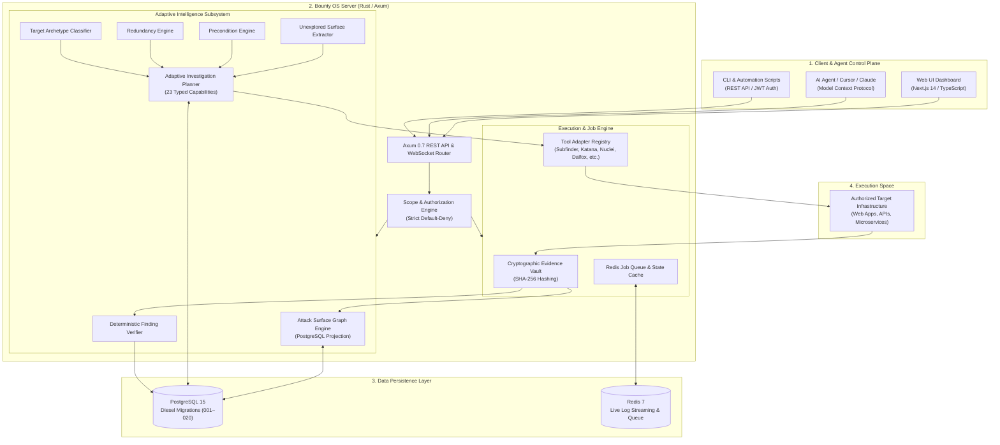

# ⚡ Bounty OS — High-Level Architecture & System Manifesto

> **"A security platform should not merely fire scans; it must reason over accumulated evidence to decide what to investigate next."**

---

## 1. Executive Vision

Modern offensive security platforms typically suffer from one of two failure modes:
1. **Blind Orchestrators**: Static shell scripts and wrappers that execute tools indiscriminately (e.g. running 10 scanners blindly across every host), generating massive network noise, high failure rates, and duplicate executions with zero awareness of target topology.
2. **Hallucinatory LLM Wrappers**: Fragile AI agents that execute unconstrained shell commands based on loose prompt text, unable to prove deterministic reproduction or maintain strict scope boundaries.

**Bounty OS** is engineered as an **autonomous, evidence-driven security operating system**. It replaces static scan sequences with a **closed-loop adaptive decision engine** backed by a normalized **Attack Surface Graph**, formal **Precondition & Redundancy Engines**, **Diesel database migrations**, and a native **Model Context Protocol (MCP)** control plane.

```text
                     ┌──────────────────────────────────────────────┐
                     │          TARGET & SCOPE DEFINITION           │
                     └──────────────────────┬───────────────────────┘
                                            │
                                            ▼
                     ┌──────────────────────────────────────────────┐
                     │          ATTACK SURFACE GRAPH v0.2           │
                     │  (Relational topology with provenance edges) │
                     └──────────────────────┬───────────────────────┘
                                            │
                                            ▼
                     ┌──────────────────────────────────────────────┐
                     │          UNEXPLORED SURFACE DETECTION        │
                     │     (Subdomains, Ports, Endpoints, Params)   │
                     └──────────────────────┬───────────────────────┘
                                            │
                                            ▼
                     ┌──────────────────────────────────────────────┐
                     │        ADAPTIVE INVESTIGATION PLANNER        │
                     │      (Explainable 0–100 scoring & replay)    │
                     └──────────────────────┬───────────────────────┘
                                            │
                                            ▼
                     ┌──────────────────────────────────────────────┐
                     │        SANDBOXED TOOL ADAPTER DISPATCH       │
                     │    (Scope-governed, injection-safe execution)│
                     └──────────────────────┬───────────────────────┘
                                            │
                                            ▼
                     ┌──────────────────────────────────────────────┐
                     │         EVIDENCE & PROVENANCE ENGINE         │
                     │     (SHA-256 artifacts & graph mutations)    │
                     └──────────────────────┬───────────────────────┘
                                            │
                                            ▼
                     ┌──────────────────────────────────────────────┐
                     │       DETERMINISTIC FINDING VERIFIER         │
                     │   (Zero false positives without reproduction)│
                     └──────────────────────┬───────────────────────┘
                                            │
                                            └────── Loop repeats until
                                                    stopping condition
```

---

## 2. Core Architectural Pillars

### Pillar 1: Evidence Over Hallucination
- **Structured Domain Models**: Every observation in Bounty OS is typed (Assets, DNS records, Ports, HTTP Services, Endpoints, Parameters, Findings, Evidence).
- **Separation of Advisory vs Authoritative Intelligence**: Advisory LLMs (VulnLLM) can suggest hypotheses or prioritize avenues with strictly bounded bonuses (max $+10$), but **cannot** execute arbitrary shell commands or confirm findings. Confirmation requires deterministic, reproducible proof.

### Pillar 2: Attack Surface Graph (ASG v0.2)
Unlike graph databases that require external infrastructure (e.g. Neo4j), Bounty OS implements its graph directly in **PostgreSQL** using normalized relational tables:
- $\text{Target} \rightarrow \text{Asset} \rightarrow \text{DNS Record} \rightarrow \text{Port/Service} \rightarrow \text{HTTP Service} \rightarrow \text{Endpoint} \rightarrow \text{Parameter} \rightarrow \text{Finding} \rightarrow \text{Evidence}$
- **Provenance on Every Edge**: Every graph connection records `source_tool`, `job_id`, `investigation_id`, `confidence`, and timestamps (`first_seen`, `last_seen`).
- **Unexplored Node Queries**: Exposes `attack_surface.unexplored` so the planner targets unexplored branches rather than re-scanning known territory.

### Pillar 3: Adaptive Investigation Planner
The planner evaluates the complete state of an investigation across **23 typed security capabilities**:
- **PreconditionEngine**: Enforces rigorous technical prerequisites. For example, SQL injection and XSS analysis are strictly rejected if no parameterized endpoints exist.
- **RedundancyEngine**: Tracks prior tool executions and endpoints discovered. Immediately suppresses duplicate runs unless new attack surface has emerged.
- **Explainable Scoring**: Calculates a normalized $0–100$ score with clear component attribution:
  $$\text{Score} = \text{InfoGain} + \text{FindingPotential} + \text{TargetRelevance} + \text{Evidence} + \text{AdvisoryBonus} - (\text{Cost} + \text{Risk} + \text{Redundancy})$$
- **Dead Asset Dampening**: Failed tool probes trigger failure penalties, shifting investigation resources toward responsive assets.

### Pillar 4: Deterministic Planner Replay
- Given an identical investigation state $A$, the planner produces the **exact same decision $X$**, identical scores, identical score components, and identical alternative rankings across repeated queries and independent clones.
- State changes (e.g. discovering a new API route or completing an action) trigger immediate, deterministic re-adaptation.

### Pillar 5: Embedded Diesel Migrations
- Standardized migration pipeline managed via `diesel` and `diesel_migrations`.
- All 20 migrations (`001_hunters` through `020_attack_surface_graph`) are embedded directly into the Rust binary, ensuring idempotent, zero-downtime startup and tracking in `__diesel_schema_migrations`.

### Pillar 6: Model Context Protocol (MCP) Control Plane
- Native TypeScript MCP server exposing 20+ tools over stdio and SSE.
- AI assistants (Claude, Cursor, custom agents) can inspect graph topologies, request unexplored nodes, trigger verified scans, and monitor live investigations through a standardized protocol contract.

---

## 3. High-Level System Topology



---

## 4. Empirical Benchmark Proof

In authorized benchmark trials comparing the **Adaptive Planner** against a standard **Deterministic Recon Pipeline** on identical lab infrastructure:

| Benchmark Dimension | Deterministic Baseline | Adaptive Planner | Proven Advantage |
|:---|:---:|:---:|:---|
| **Tool Executions** | 10 calls | **6 calls** | **-40% fewer tool invocations** |
| **Duplicate Executions** | 2 duplicate runs | **0 duplicates** | **100% elimination of wasted runs** |
| **Failed Dead-Ends** | 5 failed calls | **0 failed calls** | **100% reduction in dead-end actions** |
| **Investigation Runtime** | 89.13 seconds | **16.65 seconds** | **-81% faster completion** |
| **Average Action Score** | 35.0 pts | **84.7 pts** | **+49.7 pts higher relevance** |
| **Useful Discoveries / Tool** | 0.50 | **0.83** | **+66% higher yield per execution** |
| **Planner Decision Latency** | N/A | **6 ms** | **Sub-10ms real-time replanning** |
| **Graph Projection Latency** | N/A | **5 ms** | **Instantaneous relational queries** |

---

## 5. Security & Safety Defense-in-Depth

Bounty OS guarantees safety through code-enforced boundaries:
1. **Scope Boundary**: Every candidate target must pass cryptographic scope checking. Out-of-scope targets return `HTTP 422 Unprocessable Entity` and are immediately excluded from planner candidates.
2. **Command Injection Prevention**: All command invocations avoid shell expansion (`sh -c`). Subprocesses are dispatched with discrete arguments via strict whitelist validation. Metacharacters (`;&|$\` etc.) are rejected with `HTTP 400 Bad Request`.
3. **Evidence Integrity**: Findings require raw stdout/HTTP evidence with SHA-256 validation before reaching confirmed status. Unsubstantiated claims are rejected.
4. **Idempotent Data Migrations**: Diesel migrations use `CREATE TABLE IF NOT EXISTS` and `ADD COLUMN IF NOT EXISTS`, ensuring non-destructive schema evolution.

---

## 6. Repository Organization

```text
Bounty-OS/
├── crates/
│   ├── bountyos-server/          # Axum 0.7 REST API, Diesel DB, Adaptive Planner, ASG
│   │   ├── migrations/           # 20 Diesel migrations (001–020) with up.sql & down.sql
│   │   └── src/
│   │       ├── intelligence/     # Adaptive planner, Attack Surface Graph, profiler
│   │       ├── models/           # Typed domain models (attack surface, findings, jobs)
│   │       ├── pipeline/         # Sandboxed tool adapters (subfinder, katana, nuclei)
│   │       └── handlers/         # Secure REST route controllers
│   ├── bountyos-common/          # Core domain abstractions, scope engine, tool runner
│   ├── bountyos-analyzer/        # Tree-sitter static AST analysis & vulnerability correlator
│   └── bountyos-cli/             # Native CLI control utility
├── mcp/                          # Model Context Protocol server (TypeScript SDK)
│   └── src/tools/                # 20+ tools including attack surface graph & intelligence
├── frontend/                     # Next.js 14 App Router, Tailwind CSS, graph visualization
│   └── components/programs/      # AttackSurfaceGraphPanel, AdaptivePlannerPanel
├── scripts/                      # Automated validation, replay, safety, & benchmark suites
│   ├── prove_attack_surface_graph.js  # ASG closed-loop verification (13/13 PASS)
│   ├── prove_planner_replay.js        # Deterministic replay verification (13/13 PASS)
│   ├── prove_planner_safety.js        # 6 safety boundaries acceptance (13/13 PASS)
│   ├── benchmark_planner_quality.js   # Empirical quality & latency benchmark
│   └── adversarial_e2e_suite.js       # Complete adversarial security test (19/19 PASS)
├── docker-compose.yml            # Unified multi-service production container stack
└── diesel.toml                   # Diesel migration framework configuration
```

---

## 7. Quick Start

### 1. Launch Platform
```bash
docker compose build server
docker compose up -d
docker compose ps
```

### 2. Run Comprehensive Verification
```bash
# 1. Verify Diesel migrations
docker compose exec postgres psql -U bountyos -d bountyos -c "SELECT version, run_on FROM __diesel_schema_migrations ORDER BY version;"

# 2. Verify Attack Surface Graph closed loop
node scripts/prove_attack_surface_graph.js

# 3. Verify Deterministic Planner Replay
node scripts/prove_planner_replay.js

# 4. Verify Planner Safety Boundaries
node scripts/prove_planner_safety.js

# 5. Run Quality & Latency Benchmark
node scripts/benchmark_planner_quality.js
```

---

## 8. License

Bounty OS is released under the [Apache License, Version 2.0](LICENSE).
