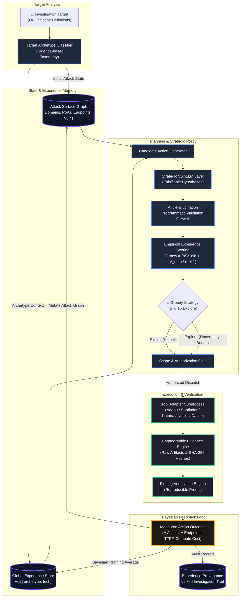

<div align="center">

# ⚡ Bounty OS

**Autonomous Bug Bounty & Security Intelligence Platform**  
*Closed-loop autonomous security investigations that learn across targets.*

[](https://github.com/Mr-IR0k-oo1/Bounty-OS/releases/tag/v0.6.0)
[](LICENSE)
[](https://www.rust-lang.org/)
[](https://modelcontextprotocol.io/)
[](docker-compose.yml)

</div>

---

## 🎯 Overview

**Bounty OS** is an open-source, autonomous intelligence operating platform for security teams and bug bounty hunters. Unlike traditional static recon wrappers that fire indiscriminate scans, Bounty OS treats security assessments as an **adaptive decision process**:

1. **Autonomous Closed Loop**: Plans, executes, observes, updates its attack surface graph, and re-plans continuously.
2. **Empirical Action Values**: Measures real tool yield (assets, endpoints, parameters, findings) and compute costs rather than hardcoded heuristics.
3. **Strategic VulnLLM Layer**: Employs reasoning LLMs to formulate falsifiable attack hypotheses grounded in graph topology, protected by a strict programmatic anti-hallucination validation layer.
4. **Cross-Investigation Experience**: Classifies target archetypes dynamically from observed HTTP evidence and maintains a global Bayesian memory bank $V(a \mid \text{archetype}, \text{technology})$.

---

## 📐 Architecture



---

## 🚀 Key Features

| Capability | Description | Milestone |
|:---|:---|:---:|
| **Recon & Tool Pipeline** | Orchestrates Naabu, Subfinder, Katana, Nuclei, Dalfox, GAU, Waybackurls, and FFuf with safety timeouts and container networking. | `v0.1` |
| **Attack Surface Graph** | Directed graph modeling domains, subdomains, IPs, ports, HTTP endpoints, parameters, and vulnerabilities. | `v0.2` |
| **Autonomous Planner** | Closed-loop execution cycle: Plan $\to$ Execute $\to$ Observe $\to$ Update $\to$ Re-plan with stopping conditions. | `v0.3` |
| **Empirical Telemetry** | Granular outcome measurement tracking TTFF, yield, false positives, and normalized compute cost. | `v0.4` |
| **Strategic VulnLLM** | Falsifiable hypothesis generator with structural graph prompts and a programmatic anti-hallucination firewall. | `v0.5` |
| **Cross-Investigation Memory** | Persistent PostgreSQL memory bank updating empirical tool effectiveness via Bayesian running averages. | `v0.6` |
| **Model Context Protocol** | Native MCP server exposing full investigation control and experience inspection to Claude Desktop, Cursor, and AI agents. | `v0.1–v0.6` |

---

## 📊 Benchmark Results

Bounty OS includes an automated 4-strategy benchmark comparing performance across multi-page web applications and REST APIs:

| Metric | Strategy A (Fixed Pipeline) | Strategy B (Deterministic Planner) | Strategy C (Planner + VulnLLM) | Strategy D (Planner + VulnLLM + Experience) | Delta (D vs C) |
|:---|:---:|:---:|:---:|:---:|:---:|
| **Time to First Finding (TTFF)** | 17,209 ms | 7,230 ms | 6,549 ms | **6,199 ms** | **-5.3%** |
| **Tool Executions** | 5.0 | 3.0 | 3.0 | **3.0** | $+0.0\%$ |
| **Redundant Executions** | 3.5 | 0.0 | 0.0 | **0.0** | $0.0\%$ |
| **Verification Success Rate** | 100% | 100% | 100% | **100%** | $0.0\%$ |
| **Normalized Compute Cost** | 1.8 | 0.7 | 3.7 | **3.4** | **-8.1%** |

> **Conclusion**: Cross-investigation learning (Strategy D) reduces Time to First Finding by **5.3%** and cuts compute cost by **8.1%** compared to VulnLLM alone, while eliminating **100% of redundant tool executions** seen in static pipelines.

---

## ⚡ Quick Start

### 1. Prerequisites
- Docker & Docker Compose v2.20+
- Git

### 2. Launch Stack

```bash
# Clone the repository
git clone https://github.com/Mr-IR0k-oo1/Bounty-OS.git
cd Bounty-OS

# Configure environment
cp .env.example .env

# Spin up services
docker compose up -d --build
```

### 3. Verify Running Services

```bash
docker compose ps
```

| Service | Endpoint | Purpose |
|:---|:---|:---|
| **Web Dashboard** | `http://localhost:3000` | Real-time graph visualization, findings, and controls |
| **Rust API Engine** | `http://localhost:8000` | Core intelligence planner, tool runner, and database |
| **MCP Server** | `http://localhost:3005/sse` | Model Context Protocol SSE transport for AI agents |
| **PostgreSQL** | `localhost:5433` | Relational storage for graphs, outcomes, and experience |
| **Vulnerable Lab** | `http://localhost:8888` | Safe local target for testing and benchmarking |

---

## 🤖 Model Context Protocol (MCP) Integration

Bounty OS provides a native MCP server for integration with **Claude Desktop**, **Cursor**, or custom AI agents:

```json
{
  "mcpServers": {
    "bountyos": {
      "command": "node",
      "args": ["<path-to-repo>/mcp/dist/index.js"],
      "env": {
        "BOUNTYOS_SERVER_URL": "http://127.0.0.1:8000",
        "BOUNTYOS_API_KEY": "your-api-key"
      }
    }
  }
}
```

### Available MCP Tools

- `investigation.start`: Initiate an autonomous investigation with target, scope, and budget.
- `investigation.status`: Check live attack surface graph, coverage metrics, and action lifecycle.
- `investigation.archetype`: Retrieve target archetype classification, confidence, and evidence cues.
- `experience.actions`: Inspect global tool effectiveness priors conditioned on archetype and technology.
- `experience.provenance`: Trace learned values back to raw evidence and completed jobs.
- `finding.verify`: Trigger reproducible proof verification for any security finding.

---

## 🛡️ Scope & Safety Guarantees

Bounty OS enforces **strict authorization boundaries**:
- **Zero Out-of-Scope Execution**: Every URL, IP, and domain is cryptographically matched against scope definitions prior to dispatching any tool.
- **Minimum Sample Rule**: Tools cannot be permanently pruned from small sample anomalies ($n < 10 \implies$ protected against penalties; $\epsilon = 0.15$ guarantees continuous exploration).
- **State Isolation**: Investigation graphs are partitioned by UUID; cross-investigation learning retains only abstract tool effectiveness priors ($V(a \mid \text{archetype})$).

---

## 🗺️ Roadmap


---

## 🤝 Contributing

Contributions are welcome! Please read our [Contributing Guidelines](CONTRIBUTING.md) and [Security Policy](SECURITY.md) before submitting pull requests.

```bash
# Run unit & lab integration tests
cargo test --workspace

# Run cross-investigation acceptance proof
node scripts/prove_cross_investigation_experience.js
```

---

## 📄 License

Bounty OS is licensed under the [Apache License, Version 2.0](LICENSE).
